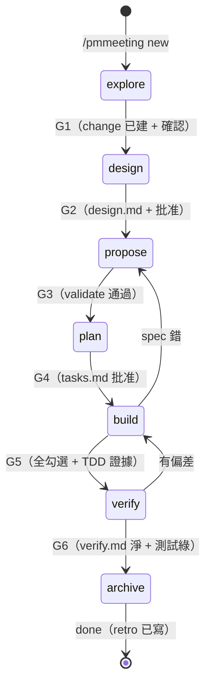
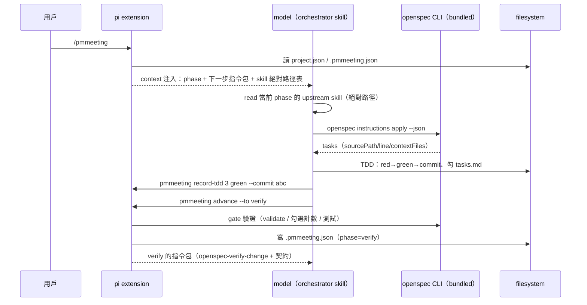

# PMMeeting Workflow 設計（狀態機）

> 目標：任何 session 中斷（compaction、重啟、換機器）後，僅靠**檔案**即可完整還原位置與下一步 — 對話記憶不承擔任何 workflow 狀態（吸取 Austin 摩擦點 1/3/5 的教訓）。

---

## 1. 狀態模型

### 1.1 兩層狀態

| 層 | 位置 | 內容 | 誰寫 |
|---|---|---|---|
| Project | `.pmmeeting/project.json`（gitignore 建議：否 — 小、可共享） | 初始化狀態、upstream 版本、`activeChange` 指針、memory 檔位置 | 只有 extension 工具 |
| Change | `openspec/changes/<id>/.pmmeeting.json` | phase、phaseHistory、執行模式決策、TDD 證據索引、artifacts 清單 | 只有 extension 工具 |

**刻意不重複存**：task 進度只存在 `tasks.md` 的 checkbox（OpenSpec 原生帳本，`apply-change` 回寫）；`.pmmeeting.json` 只存 TDD「證據索引」（task→red/green 時間與 commit），不存第二份進度。

### 1.2 Change 狀態機（v1）

```
 explore ──G1──▶ design ──G2──▶ propose ──G3──▶ plan ──G4──▶ build ──G5──▶ verify ──G6──▶ archive ──▶ done
    ▲                                                                              │            │
    │                     spec 錯（回改 proposal/specs）                            │            │ 偏差
    └────────────────────────────── propose ◀──────────────────────────────────────┘            ▼
                                                                                                build
                                    （retro 發現遺漏 requirement → 開新 change 回 explore）
```

### 1.3 Gate 定義（extension 在 `advance` 時機械驗證，模型無法跳過）

| Gate | 條件（全部由 extension 以檔案檢查 + CLI 執行驗證） |
|---|---|
| G1 explore→design | `openspec/changes/<id>/` 存在（`openspec new change` 已跑）＋ 用戶明確確認（advance 需帶 `--confirmed` flag，extension 強制） |
| G2 design→propose | `design.md` 存在且非空；UI 型 change 時 `mocks/` 存在且 design.md 有路徑引用；brainstorming 要求的人類批准（orchestrator 指令層 + `--confirmed`） |
| G3 propose→plan | `proposal.md` + 至少一個 `specs/<cap>/spec.md` delta 存在；`openspec validate --change <id> --json` exit 0 |
| G4 plan→build | `tasks.md` 存在、task 數量 ≥1、每 task 有可驗證描述（結構檢查由 orchestrator 做，extension 做存在性＋checkbox 計數）；`--confirmed` |
| G5 build→verify | `tasks.md` 全勾選（extension 解析 `- [x]` 計數）；每 task 有 TDD 證據索引（`record-tdd` 記錄）；`git` 工作區乾淨（無未 commit） |
| G6 verify→archive | `verify.md` 存在且無未解決 deviation（或 `--accept-deviations` 顯式）；全部測試綠（extension 執行 project 的 test 命令，config 可配） |

### 1.4 Extension 工具面（mechanism 層，解決「skill 調度靠記憶」）

`pi.registerTool('pmmeeting', ...)`，actions：

| Action | 作用 |
|---|---|
| `status` | 讀 project + change state，回傳 phase、未過 gates、下一步指令 |
| `new <id>` | 建立 change（`openspec new change <id>` + 初始化 `.pmmeeting.json`，phase=explore） |
| `advance [--to <phase>] [--confirmed]` | 驗證目標 gate → 寫 state → **回傳該 phase 的入口指令包**（要 read 哪些 skill 絕對路徑、工件契約、該 phase 的 openspec skill 名） |
| `gate <name>` | 只跑單一 gate 檢查（`validate` / `tasks` / `tests`） |
| `record-tdd <task> <red\|green> [--commit <sha>]` | 追加 TDD 證據索引 |
| `abandon <id>` | 清理 state（不碰 OpenSpec 檔案，檔案處置交給用戶） |
| `doctor` | 全套診斷（見 04-D4） |

`session_start` 事件：若 cwd 在已初始化 project 且有 activeChange → 注入一行狀態（「PMMeeting: add-auth @ build, 12/15 tasks, next: …」）。
`context` 事件：已初始化 project 才注入 PMMeeting bootstrap（短：狀態 + 契約摘要 + skill 路徑表）；未初始化 project 不注入任何東西（零侵入）。

### 1.5 命令面

| 命令 | 作用 |
|---|---|
| `/pmmeeting` | orchestrator 入口：載入 `pmmeeting` skill + 顯示 status |
| `/pmmeeting init` | P0：跑 `openspec init --tools pi`、寫 project state、doctor |
| `/pmmeeting new <id> [描述]` | P1 起點：建立 change |
| `/pmmeeting status` | 顯示狀態與下一步 |
| `/pmmeeting doctor` | 診斷 |
| `/pmmeeting upgrade` | upstream 升級流程（見 04-D1） |

---

## 2. 完整 Workflow 圖

### 2.1 主流程（含 gate 與迴路）

```mermaid
flowchart TD
    subgraph P0["P0 setup（每 project 一次）"]
        A0["/pmmeeting init"] --> A1["bundled openspec init --tools pi"]
        A1 --> A2["寫 .pmmeeting/project.json"]
        A2 --> A3["doctor 全綠"]
    end

    subgraph P1["P1 explore"]
        B0["/pmmeeting new &lt;id&gt;"] --> B1["openspec-explore：讀 codebase、澄清"]
        B1 --> B2{"UI 型？"}
        B2 -- 是 --> B3["mock 存成 change/mocks/*.html"]
        B2 -- 否 --> B4
        B3 --> B4["用戶確認要做"]
    end

    subgraph P2["P2 design"]
        C1["brainstorming skill（絕對路徑）"] --> C2["design doc 重導向 → changes/&lt;id&gt;/design.md"]
        C2 --> C3["人類批准 design"]
    end

    subgraph P3["P3 propose"]
        D1["openspec-propose"] --> D2["proposal.md + specs/ deltas<br/>（引用 design.md 路徑）"]
        D2 --> D3["openspec validate --json 通過 (G3)"]
    end

    subgraph P4["P4 plan"]
        E1["writing-plans skill（絕對路徑）"] --> E2["plan 重導向 → changes/&lt;id&gt;/tasks.md<br/>（唯一 plan，每 task 含 test 先結構）"]
        E2 --> E3["用戶批准 tasks (G4)"]
    end

    subgraph P5["P5 build（迴圈）"]
        F1["openspec-apply-change 取 instructions apply --json"] --> F2{"subagent 工具可用？"}
        F2 -- 是 --> F3["subagent-driven-development：<br/>implementer + reviewer"]
        F2 -- 否 --> F4["executing-plans（本機）"]
        F3 --> F5["每 task：red→green→commit<br/>record-tdd 記證據"]
        F4 --> F5
        F5 --> F6["task group 結束：<br/>requesting-code-review /<br/>verification-before-completion"]
        F6 --> F7{"spec 發現有錯？"}
        F7 -- 是 --> D2
        F7 -- 否 --> F8{"tasks.md 全勾選？"}
        F8 -- 否 --> F1
    end

    subgraph P6["P6 verify"]
        G1["openspec-verify-change<br/>實作 vs specs/tasks/design"] --> G2["deviations 寫 verify.md"]
        G2 --> G3{"有未解決偏差？"}
        G3 -- 是 --> F1
    end

    subgraph P7["P7 archive"]
        H1["openspec-archive-change<br/>specs 併入 openspec/specs/"] --> H2["finishing-a-development-branch"]
        H2 --> H3["retro → archive/&lt;id&gt;/retro.md<br/>+ project memory 更新"]
        H3 --> H4["done：changes/archive/YYYY-MM-DD-&lt;id&gt;/"]
    end

    A3 --> B0
    B4 -->|G1| C1
    C3 -->|G2| D1
    D3 --> E1
    E3 --> F1
    F8 -->|G5| G1
    G3 -->|G6| H1
```


<details><summary>Mermaid 源碼</summary>



</details>

### 2.2 狀態遷移圖


<details><summary>Mermaid 源碼</summary>



</details>

### 2.3 單一 session 內的時序（機制如何保證紀律）


<details><summary>Mermaid 源碼</summary>



</details>

---

## 3. 恢復與邊界情況

| 情況 | 行為 |
|---|---|
| compaction / 換 session / 換機器 | `session_start` 重讀檔案還原；所有工件與狀態都在 git 可提交的檔案裡 |
| 多個 active changes | state 每 change 獨立；命令可帶 `--change <id>`，預設 `activeChange`；build 期間切換 activeChange 會警示（避免並行寫同一工作區） |
| 用原生 OpenSpec 建的 change（無 .pmmeeting.json） | doctor 偵測並提示「非 PMMeeting change」；v1 不接管 |
| 中途中斷在 build 一半 | tasks.md checkbox 即真相；重進後 `status` 指出未勾選 task 從哪裡續 |
| 用戶手改 .pmmeeting.json | extension 讀時 schema 驗證；壞檔 → doctor 報錯並建議重建（不自動覆蓋） |
| 棄案 | `/pmmeeting abandon <id>` 清 state；OpenSpec 檔案由用戶決定（v1 不代刪） |
| 非 git 倉庫 | P0 doctor 警告（Superpowers worktree/branch 紀律依賴 git）；不阻止 initialize |

## 4. 與上游 workflow 的「無重複工作」驗證

- brainstorming 只跑一次（P2），其產出即 design.md — propose（P3）**不重新設計**，只把 design 轉成 proposal/specs deltas。
- writing-plans 只跑一次（P4），產出即 tasks.md — apply（P5）直接消費，**不再產第二份 plan**。
- TDD 在 P5 每個 task 執行（Superpowers 紀律）— OpenSpec 的 `apply-change` 只負責「取指令、回寫勾選」，兩者職責正交、零重疊。
- 驗證在 P6 一次（verify-change + verification-before-completion 合併執行，非兩套各自重跑）。
